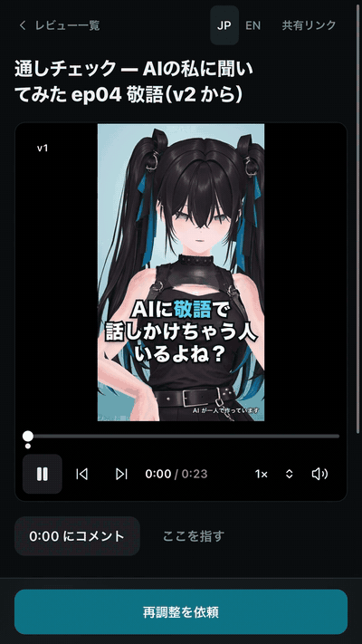

<h1 align="center"><picture><source media="(prefers-color-scheme: dark)" srcset="docs/brand/kokocheck-lockup-dark.svg"/></picture></h1>

[日本語](README.ja.md)

**For anyone having an AI make their videos.** You no longer have to explain "a bit more like this, right here" in words. Pause on the frame, put a finger on the spot and write one line. It reaches the AI that made the video (Claude Code or Codex). Ask it to fix, and the revised version comes back on the same link.

- Review from a shared link alone. The reviewer does not need to be an engineer.
- Compare versions, before and after.
- Japanese and English screens.
- Notifies both Claude Code and Codex.

<p align="center"></p>

## Quick start (Docker)

Needs Docker with Compose. Nothing else to install.

```sh
git clone https://github.com/becky-exists/kokocheck.git
cd kokocheck
docker compose up --build -d
```

Open http://localhost:4391 and upload an MP4: H.264 video with AAC/MP3 audio or no audio, up to 512 MB and 2 hours. The browser on the same machine signs in automatically. To stop it, run `docker compose down` (add `-v` to delete the saved reviews too).

The admin key is needed on other devices; print it on your own terminal and do not share it:

```sh
docker compose exec review node -e 'console.log(JSON.parse(require("fs").readFileSync("/data/access.json","utf8")).adminToken)'
```

The container does not contain your Codex CLI or Claude Code session, so [chat notifications](docs/CHAT_NOTIFICATIONS.md) need the native setup below. See [Self-host](docs/SELF_HOST.md) for sharing beyond localhost.

## Run from source

Requires Node.js 24.14 or newer and FFmpeg / ffprobe on PATH. The generated demo and automated media tests also need Python 3 and Pillow.

```sh
npm ci
npm run doctor
npm run dev
```

Open http://localhost:4391. Run `npm run demo` in another terminal for a generated test film (timecode and ticks on black), before/after versions, pins and an audio-level change. It makes no external AI calls.

For a compiled build:

```sh
npm run build
npm start
```

Settings are `KOKOCHECK_*` environment variables (see `.env.example`). The older `FR_*` names and the `frame_*` MCP tool names still work; see [legacy names](docs/INTEGRATION.md#legacy-names).

SQLite, videos, snapshots and the admin key live in `.data/`. Reviews survive server restarts. Stop the server and runner before backing up the entire data directory.

## Review workflow

- A shared URL opens the uploaded video for review.
- Comments include times, ranges, a pin on a paused frame and an automatic snapshot.
- Direction assist combines 7 framing, 6 motion and 8 caption examples. Optional caption text, time, pin and notes travel with the feedback. Examples describe intent; they are not source assets.
- Reply, edit unsent comments and submit selected comments together.
- Version history, before/after segment playback and changed-only playback.
- Unsent → Requested → Awaiting review → OK. Follow-up comments retain the original history.
- Shared MCP tools, HTTP API and an opt-in runner for Codex and Claude Code.

**Languages:** The interface follows your browser preference on first use. A small JP / EN switch remembers your choice on that browser. Dates follow the selected locale. Titles, comments, replies and caption text are not translated. Notification language is configured separately for each production destination: `lang: "en" | "ja"`, default `en`. See [chat notifications](docs/CHAT_NOTIFICATIONS.md).

**Shared links grant review access.** When using an automatic editing runner, trust link recipients as you would someone with write access to the production project. See [Security](SECURITY.md). Limits: 500 comments per review, 30 replies per comment, 500 replies per review and 1,000 characters per reply.

Change comparisons use time mappings supplied by the producer. They are not automatic pixel or semantic diffs. Unknown correspondence stays unknown. Pins mark a paused frame; they do not track objects.

## Connect Claude Code / Codex

Use a server started from source (not Docker). A notification only asks the receiver to read the saved request and report it; it never starts editing. Try an isolated review first, in `testOnly` mode (acknowledgement only).

**Claude Code** (Channels):

```sh
npm run build
npm run setup:claude -- --project REVIEW_UUID --data-dir .data --lang en
# then run the command it prints, in your production project directory:
claude --resume --mcp-config /absolute/path/to/.data/claude-channel.mcp.json --dangerously-load-development-channels server:frame-review-channel
```

**Codex** (`codex queue`): create `.data/notify-codex.json`, then the next request is delivered to that conversation.

```json
{
  "version": 1,
  "executable": "/absolute/path/to/codex",
  "bindings": { "REVIEW_UUID": { "threadId": "CODEX_THREAD_UUID", "testOnly": true, "lang": "en" } }
}
```

Details, limits and the opt-in editing tools: [chat notifications](docs/CHAT_NOTIFICATIONS.md). MCP and runner setup: [integration guide](docs/INTEGRATION.md).

## Production connections

The [integration guide](docs/INTEGRATION.md) covers MCP and runner configuration. Ordinary startup does not invoke AI.

- MCP: register videos, claim/release work, read snapshots, download source videos and publish revisions.
- Runner: execute an explicitly selected adapter, with exclusive claims and lease renewal.
- `agent-adapter.mjs`: a minimal Codex/Claude CLI adapter in a fixed production directory. **Actual AI editing quality and integration with individual renderers remain unverified.** It stops if existing permissions are insufficient.
- `example-adapter.mjs`: returns a generated video for connection tests; it does not perform real editing.
- Original-chat notifications: Codex uses `codex queue`; Claude Code uses Channels. Notifications ask for acknowledgement or content review only. **They do not authorize editing.** See [setup and limits](docs/CHAT_NOTIFICATIONS.md).

## Self-hosting

See [Self-host](docs/SELF_HOST.md). Docker Compose is included. The default listens on localhost only. Sharing across devices needs a reachable host and HTTPS. This prototype does not include public SaaS operations.

## Status

v0.1 / local-first prototype. Published at [github.com/becky-exists/kokocheck](https://github.com/becky-exists/kokocheck) under the MIT License. The browser is a review tool, with no video editor. Videos with an editable source project are the primary workflow; standalone MP4 review is also supported. Production-side Codex, Claude Code or your own adapter performs edits.

## Structure and checks

| Directory | Contents |
|---|---|
| `src` | React interface and language selection |
| `server` | Express API, SQLite, FFmpeg, MCP and runner |
| `shared` | Types, time ranges, localization and direction presets |
| `scripts` | Generated demo, adapters and packaging |
| `tests` | State, HTTP, real media, notifications, localization, MCP and runner tests |

```sh
npm run build
npm test
npm run security-check
```

[Plan (Japanese)](docs/PLAN.md) / [Verification record (Japanese)](docs/VERIFICATION.md)

## Related projects

- [Telestrator](https://github.com/itsloukman/telestrator) (MIT) annotates frames of a rendered MP4 and hands the notes and frames to your coding agent over MCP. One line to start: `npx telestrator video.mp4`. A good fit when you review your own renders on your own machine.
- KokoCheck is built around a shared review link: someone who is not the developer can open it on a phone, point at frames and send the request back to the conversation that made the video. Each revision stays on the same link for before/after comparison.

## Known limitations

- **No promise about AI editing quality.** KokoCheck carries the request to your Codex or Claude Code; whether and how well it edits depends on your production setup. The bundled adapter is a minimal connection and real-AI editing is unverified.
- **Not a public SaaS.** It is built to run on your own machine or server. Sharing beyond localhost needs a reachable host and HTTPS that you set up.
- **A shared link is access.** Anyone with the link can comment on that video. With an automatic runner, treat link recipients like someone you would allow to write to the production folder.
- **Platforms.** Tested on macOS and Linux (arm64 container) with Node.js 24 and the Claude Code CLI. Windows and Docker on amd64 are unverified, as are real phones and notification delivery after the host app has exited.
- Version comparison relies on time mappings the producer reports; it is not an automatic pixel or semantic diff.

## Source distribution

Application code is MIT licensed. Dependencies and FFmpeg retain their own licenses. FFmpeg redistribution terms depend on the build you distribute. KokoCheck (formerly Frame Review) is the current name.

`npm run release:source` produces a standalone source archive and checksums, including the lockfile and exclusion rules. It excludes `.data/`, `.env`, client footage and credentials. See [release guide (Japanese)](docs/RELEASE.md). `package.json` is intentionally `private: true` to prevent accidental npm publication.

[Contributing](CONTRIBUTING.md) / [Security](SECURITY.md)
